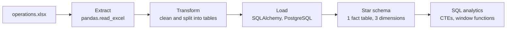
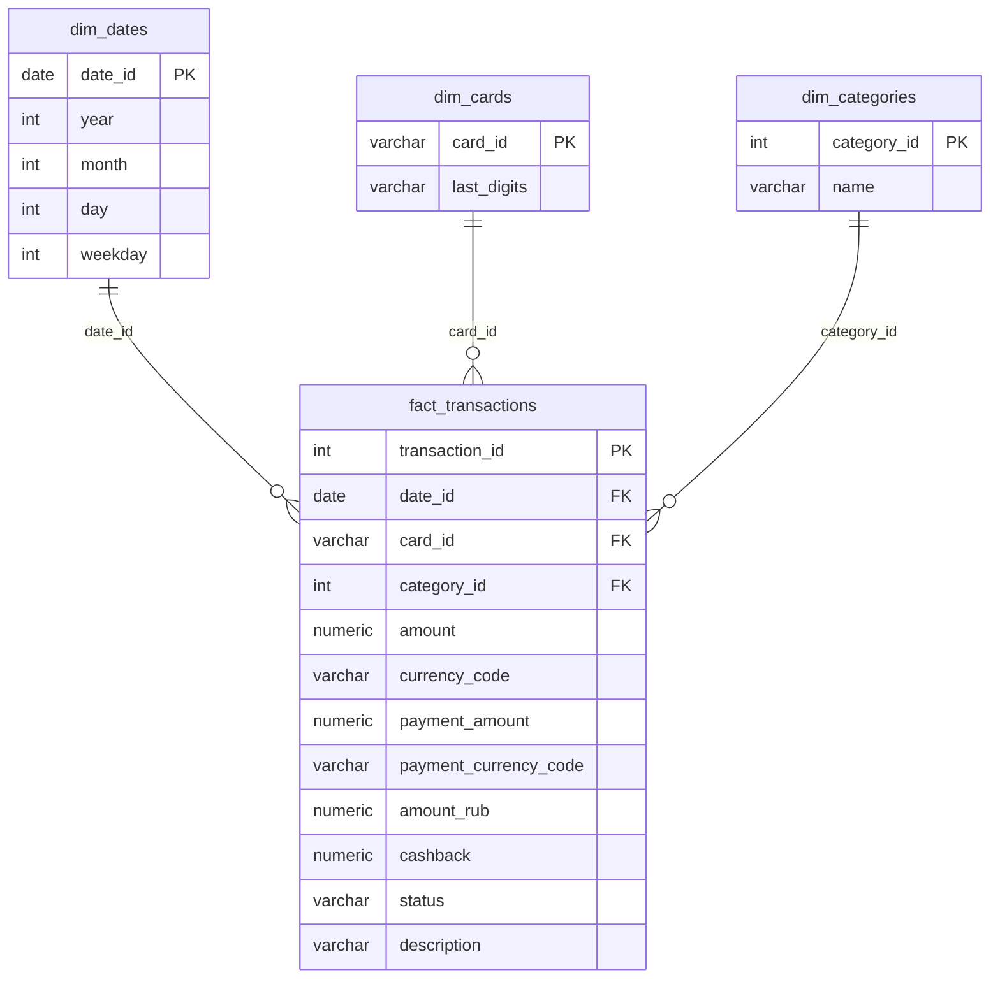

# Transactions ETL Pipeline

**English** | [Русский](README.ru.md)

[](https://github.com/GrandBalaxon/transactions-etl-pipeline/actions/workflows/etl_pipeline_ci.yml)
[](https://github.com/GrandBalaxon/transactions-etl-pipeline/tree/python-coverage-comment-action-data)
[](LICENSE)
[](https://www.python.org)

[](https://pandas.pydata.org/)
[](https://www.postgresql.org/)
[](https://www.sqlalchemy.org/)
[](https://www.docker.com/)
[](https://pytest.org/)

An ETL pipeline that reads a bank statement from an Excel file, cleans it with pandas and loads it into a PostgreSQL star schema. Three SQL queries with CTEs and window functions run on top of the loaded data.

## What it does



| Stage | What happens |
|---|---|
| Extract | Reads the Excel file into a DataFrame. |
| Transform | Keeps only operations with status `OK`, drops exact duplicate rows, parses dates, fills missing card numbers and categories with `Unknown`, builds three dimension tables and one fact table, calculates the amount in rubles. |
| Load | Creates the tables if they do not exist, clears them and loads the dimensions and then the facts. Every run is a full reload, so running the pipeline twice gives the same result. |

Results for the sample file `data/operations.xlsx` (bank card operations from 2018-01-01 to 2021-12-31):

| Step | Rows |
|---|---:|
| Rows in the source file | 6,705 |
| Removed: status `FAILED` | 42 |
| Removed: exact duplicates | 8 |
| Loaded into `fact_transactions` | 6,655 |

The dimensions hold 4 cards (one of them is `Unknown`, for operations without a card number), 49 categories and 1,391 dates.

## Tech stack

- Python 3.13+, pandas, openpyxl
- PostgreSQL 16, SQLAlchemy 2, psycopg 3
- Docker and Docker Compose
- pytest, coverage, flake8, isort, mypy (strict)
- Poetry, GitHub Actions

## Data model



Each transaction keeps two amounts from the source file:

- `amount` and `currency_code`: the operation as it happened at the merchant (for example, 100 USD);
- `payment_amount` and `payment_currency_code`: what was charged to the card account.

`amount_rub` is the amount used by the analytics. It is filled by this rule:

1. if the payment currency is RUB, take `payment_amount`;
2. otherwise, if the operation currency is RUB, take `amount`;
3. otherwise leave it `NULL`.

In the sample file 6,641 transactions get a ruble amount and 14 transactions (operation and payment both in CNY) stay `NULL`. The queries skip those rows instead of adding yuan to rubles.

Money is stored as `NUMERIC(12, 2)`, not as a floating-point type.

## Quick start with Docker

Requirements: Docker with Docker Compose.

```bash
git clone https://github.com/GrandBalaxon/transactions-etl-pipeline.git
cd transactions-etl-pipeline

# start PostgreSQL
docker compose up -d db

# build the image and run the pipeline on data/operations.xlsx
docker compose build app
docker compose run --rm app
```

The last lines of the log should be:

```text
... - INFO - Loaded 6655 rows into fact_transactions.
... - INFO - === ETL PIPELINE FINISHED ===
```

To load another file, put it into the `data/` folder and pass its path:

```bash
docker compose run --rm app run --file data/my_file.xlsx
```

The file must have the same columns as `data/operations.xlsx`.

To stop the database and delete its data:

```bash
docker compose down -v
```

## Running the SQL queries

The queries are in the `sql/` folder. Run one against the database container:

```bash
docker compose exec -T db psql -U postgres -d transactions_db < sql/03_category_share_december_2021.sql
```

In PowerShell use a pipe instead of `<`:

```powershell
Get-Content sql/03_category_share_december_2021.sql | docker compose exec -T db psql -U postgres -d transactions_db
```

Category and merchant names come from the source file, so they are in Russian.

### 1. Top 3 expenses in each category

[`sql/01_top_3_expenses_per_category.sql`](sql/01_top_3_expenses_per_category.sql) uses a CTE and `ROW_NUMBER() OVER (PARTITION BY ...)`. It returns 126 rows; the first ones are:

| category_name | description | amount |
|---|---|---:|
| Duty Free | Regstaer-M Dtp | 60.00 |
| Авиабилеты | Аэрофлот | 7322.00 |
| Авиабилеты | Авиакомпания UTair | 5960.00 |
| Авиабилеты | Aviacassa | 5748.00 |
| Автоуслуги | Kia Odisseya-Spb | 15000.00 |
| Аптеки | Аптека Вита | 2863.40 |
| Аптеки | Apteka 7 | 2418.11 |
| Аптеки | Аптека Вита | 1986.00 |

Авиабилеты = air tickets, Автоуслуги = car services, Аптеки = pharmacies.

### 2. Daily expenses with a running total

[`sql/02_running_total_expenses.sql`](sql/02_running_total_expenses.sql) aggregates expenses by day in a CTE and adds a running total with `SUM() OVER (ORDER BY ... ROWS BETWEEN UNBOUNDED PRECEDING AND CURRENT ROW)`. It returns 1,385 rows:

| date_id | daily_amount | running_total |
|---|---:|---:|
| 2018-01-01 | 3316.00 | 3316.00 |
| 2018-01-03 | 94.06 | 3410.06 |
| 2018-01-04 | 2090.90 | 5500.96 |
| ... | ... | ... |
| 2021-12-30 | 20357.39 | 8340808.79 |
| 2021-12-31 | 1785.06 | 8342593.85 |

### 3. Share of each category in December 2021 expenses

[`sql/03_category_share_december_2021.sql`](sql/03_category_share_december_2021.sql) uses two CTEs and a `CROSS JOIN` with the monthly total. It returns 26 rows; the top five are:

| category_name | category_total | percentage |
|---|---:|---:|
| Переводы | 69986.17 | 54.52 |
| ЖКХ | 14216.42 | 11.07 |
| Каршеринг | 9370.11 | 7.30 |
| Дом и ремонт | 6077.10 | 4.73 |
| Супермаркеты | 5670.71 | 4.42 |

Переводы = money transfers, ЖКХ = utilities, Каршеринг = car sharing, Дом и ремонт = home and renovation, Супермаркеты = supermarkets.

## Local development

Requirements: Python 3.13 or newer, [Poetry](https://python-poetry.org/), Docker.

```bash
# install dependencies, including the test and lint groups
poetry install

# create the settings file; the default values match docker-compose.yml
cp .env.example .env

# start the working database and run the pipeline
docker compose up -d db
poetry run python -m cli run --file data/operations.xlsx
```

Connection settings are read from `.env`:

| Variable | Default | Meaning |
|---|---|---|
| `POSTGRES_USER` | `postgres` | database user |
| `POSTGRES_PASSWORD` | `postgres` | database password |
| `POSTGRES_DB` | `transactions_db` | working database name |
| `POSTGRES_HOST` | `localhost` | database host |
| `POSTGRES_PORT` | `5433` | port published by the `db` container |
| `TEST_DATABASE_URL` | see `.env.example` | connection URL of the test database |

## Tests and code quality

Integration and SQL tests run against a separate PostgreSQL database, `transactions_test`, on port 5434. The test fixture refuses to run against any other database, so the tests cannot erase the working data.

```bash
# start the test database
docker compose --profile testing up -d test-db

# run the tests with coverage
poetry run coverage run -m pytest
poetry run coverage report -m

# linters and type checking
poetry run flake8 src tests cli.py
poetry run isort --check-only src tests cli.py
poetry run mypy src cli.py
```

The tests cover the transform logic, a full pipeline run from an Excel file to PostgreSQL, and the result of each SQL query on a known data set.

GitHub Actions runs the linters, the tests with a PostgreSQL service and a Docker image build on every pull request and on every push to `main` and `develop`.

## Project structure

```text
.
├── cli.py                   # command-line entry point
├── src/
│   ├── database.py          # connection settings, engine, table creation
│   ├── models.py            # SQLAlchemy models of the star schema
│   └── pipeline.py          # extract, transform, load
├── sql/                     # analytical queries
├── tests/                   # unit, integration and SQL tests
├── data/operations.xlsx     # sample source file
├── Dockerfile
├── docker-compose.yml       # db, test-db and app services
└── .github/workflows/       # CI
```

## Known limitations and roadmap

- Every run is a full reload: the tables are cleared and loaded again. Incremental loading is not implemented.
- 14 transactions in yuan have no ruble amount. The next step is to load historical exchange rates from a public API and convert them.
- Only the operation date is stored; the time of day is dropped.
- Exact duplicate rows are removed without a report. A data-quality report with rejected rows and reasons is planned.
- A file with missing columns stops the pipeline with an error; there is no column validation with a clear message yet.

## License

This project is licensed under the [MIT License](LICENSE).
