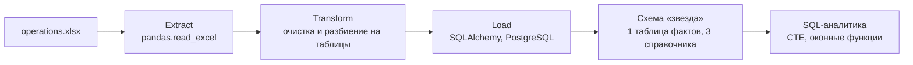
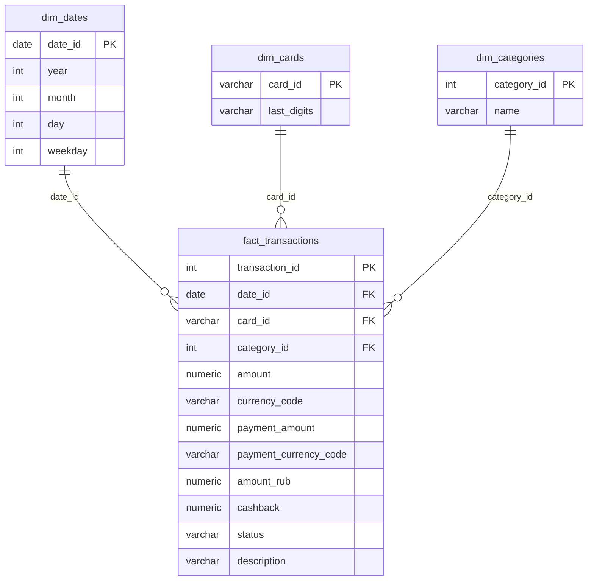

# Transactions ETL Pipeline

[English](README.md) | **Русский**

[](https://github.com/GrandBalaxon/transactions-etl-pipeline/actions/workflows/etl_pipeline_ci.yml)
[](https://github.com/GrandBalaxon/transactions-etl-pipeline/tree/python-coverage-comment-action-data)
[](LICENSE)
[](https://www.python.org)

ETL-пайплайн, который читает банковскую выписку из Excel-файла, очищает её с помощью pandas и загружает в PostgreSQL по схеме «звезда». Поверх загруженных данных работают три SQL-запроса с CTE и оконными функциями.

## Что делает проект



| Этап | Что происходит |
|---|---|
| Extract | Excel-файл читается в DataFrame. |
| Transform | Остаются только операции со статусом `OK`, удаляются полные дубликаты строк, разбираются даты, пустые номера карт и категории заменяются на `Unknown`, строятся три справочника и таблица фактов, рассчитывается сумма в рублях. |
| Load | Таблицы создаются, если их ещё нет, очищаются, затем загружаются справочники и факты. Каждый запуск — полная перезагрузка, поэтому повторный запуск даёт тот же результат. |

Результаты для файла-примера `data/operations.xlsx` (операции по банковским картам с 01.01.2018 по 31.12.2021):

| Шаг | Строк |
|---|---:|
| Строк в исходном файле | 6 705 |
| Удалено: статус `FAILED` | 42 |
| Удалено: полные дубликаты | 8 |
| Загружено в `fact_transactions` | 6 655 |

В справочниках 4 карты (одна из них — `Unknown`, для операций без номера карты), 49 категорий и 1 391 дата.

## Стек

- Python 3.13+, pandas, openpyxl
- PostgreSQL 16, SQLAlchemy 2, psycopg 3
- Docker и Docker Compose
- pytest, coverage, flake8, isort, mypy (strict)
- Poetry, GitHub Actions

## Модель данных



Для каждой транзакции сохраняются две суммы из исходного файла:

- `amount` и `currency_code` — операция в том виде, в каком она прошла у продавца (например, 100 USD);
- `payment_amount` и `payment_currency_code` — сколько списано со счёта карты.

`amount_rub` — сумма, по которой считается аналитика. Она заполняется по правилу:

1. если валюта платежа — RUB, берётся `payment_amount`;
2. иначе, если валюта операции — RUB, берётся `amount`;
3. иначе остаётся `NULL`.

В файле-примере рублёвую сумму получает 6 641 транзакция, а 14 транзакций (операция и платёж в CNY) остаются с `NULL`. Запросы пропускают эти строки, а не складывают юани с рублями.

Деньги хранятся в `NUMERIC(12, 2)`, а не в типе с плавающей точкой.

## Быстрый старт в Docker

Требования: Docker с Docker Compose.

```bash
git clone https://github.com/GrandBalaxon/transactions-etl-pipeline.git
cd transactions-etl-pipeline

# запустить PostgreSQL
docker compose up -d db

# собрать образ и запустить пайплайн на data/operations.xlsx
docker compose build app
docker compose run --rm app
```

Последние строки лога должны быть такими:

```text
... - INFO - Loaded 6655 rows into fact_transactions.
... - INFO - === ETL PIPELINE FINISHED ===
```

Чтобы загрузить другой файл, положите его в папку `data/` и передайте путь:

```bash
docker compose run --rm app run --file data/my_file.xlsx
```

В файле должны быть те же колонки, что и в `data/operations.xlsx`.

Остановить базу и удалить её данные:

```bash
docker compose down -v
```

## Запуск SQL-запросов

Запросы лежат в папке `sql/`. Запрос выполняется в контейнере базы данных:

```bash
docker compose exec -T db psql -U postgres -d transactions_db < sql/03_category_share_december_2021.sql
```

В PowerShell вместо `<` используется конвейер:

```powershell
Get-Content sql/03_category_share_december_2021.sql | docker compose exec -T db psql -U postgres -d transactions_db
```

### 1. Три крупнейших расхода в каждой категории

[`sql/01_top_3_expenses_per_category.sql`](sql/01_top_3_expenses_per_category.sql) использует CTE и `ROW_NUMBER() OVER (PARTITION BY ...)`. Запрос возвращает 126 строк, первые из них:

| category_name | description | amount |
|---|---|---:|
| Duty Free | Regstaer-M Dtp | 60.00 |
| Авиабилеты | Аэрофлот | 7322.00 |
| Авиабилеты | Авиакомпания UTair | 5960.00 |
| Авиабилеты | Aviacassa | 5748.00 |
| Автоуслуги | Kia Odisseya-Spb | 15000.00 |
| Аптеки | Аптека Вита | 2863.40 |
| Аптеки | Apteka 7 | 2418.11 |
| Аптеки | Аптека Вита | 1986.00 |

### 2. Расходы по дням с накопительным итогом

[`sql/02_running_total_expenses.sql`](sql/02_running_total_expenses.sql) суммирует расходы по дням в CTE и добавляет накопительный итог через `SUM() OVER (ORDER BY ... ROWS BETWEEN UNBOUNDED PRECEDING AND CURRENT ROW)`. Запрос возвращает 1 385 строк:

| date_id | daily_amount | running_total |
|---|---:|---:|
| 2018-01-01 | 3316.00 | 3316.00 |
| 2018-01-03 | 94.06 | 3410.06 |
| 2018-01-04 | 2090.90 | 5500.96 |
| ... | ... | ... |
| 2021-12-30 | 20357.39 | 8340808.79 |
| 2021-12-31 | 1785.06 | 8342593.85 |

### 3. Доля каждой категории в расходах декабря 2021 года

[`sql/03_category_share_december_2021.sql`](sql/03_category_share_december_2021.sql) использует два CTE и `CROSS JOIN` с итогом за месяц. Запрос возвращает 26 строк, первые пять:

| category_name | category_total | percentage |
|---|---:|---:|
| Переводы | 69986.17 | 54.52 |
| ЖКХ | 14216.42 | 11.07 |
| Каршеринг | 9370.11 | 7.30 |
| Дом и ремонт | 6077.10 | 4.73 |
| Супермаркеты | 5670.71 | 4.42 |

## Локальная разработка

Требования: Python 3.13 или новее, [Poetry](https://python-poetry.org/), Docker.

```bash
# установить зависимости, включая группы для тестов и линтеров
poetry install

# создать файл настроек; значения по умолчанию совпадают с docker-compose.yml
cp .env.example .env

# запустить рабочую базу и пайплайн
docker compose up -d db
poetry run python -m cli run --file data/operations.xlsx
```

Настройки подключения читаются из `.env`:

| Переменная | По умолчанию | Значение |
|---|---|---|
| `POSTGRES_USER` | `postgres` | пользователь базы данных |
| `POSTGRES_PASSWORD` | `postgres` | пароль |
| `POSTGRES_DB` | `transactions_db` | имя рабочей базы |
| `POSTGRES_HOST` | `localhost` | хост базы данных |
| `POSTGRES_PORT` | `5433` | порт, опубликованный контейнером `db` |
| `TEST_DATABASE_URL` | см. `.env.example` | строка подключения к тестовой базе |

## Тесты и качество кода

Интеграционные и SQL-тесты работают с отдельной базой PostgreSQL `transactions_test` на порту 5434. Тестовая фикстура отказывается работать с любой другой базой, поэтому тесты не могут стереть рабочие данные.

```bash
# запустить тестовую базу
docker compose --profile testing up -d test-db

# запустить тесты с покрытием
poetry run coverage run -m pytest
poetry run coverage report -m

# линтеры и проверка типов
poetry run flake8 src tests cli.py
poetry run isort --check-only src tests cli.py
poetry run mypy src cli.py
```

Тесты проверяют логику трансформации, полный запуск пайплайна от Excel-файла до PostgreSQL и результат каждого SQL-запроса на известном наборе данных.

GitHub Actions запускает линтеры, тесты с сервисом PostgreSQL и сборку Docker-образа на каждый pull request и на каждый push в `main` и `develop`.

## Структура проекта

```text
.
├── cli.py                   # точка входа командной строки
├── src/
│   ├── database.py          # настройки подключения, engine, создание таблиц
│   ├── models.py            # модели SQLAlchemy для схемы «звезда»
│   └── pipeline.py          # extract, transform, load
├── sql/                     # аналитические запросы
├── tests/                   # модульные, интеграционные и SQL-тесты
├── data/operations.xlsx     # файл-пример
├── Dockerfile
├── docker-compose.yml       # сервисы db, test-db и app
└── .github/workflows/       # CI
```

## Ограничения и планы

- Каждый запуск — полная перезагрузка: таблицы очищаются и загружаются заново. Инкрементальной загрузки нет.
- У 14 транзакций в юанях нет рублёвой суммы. Следующий шаг — загрузить исторические курсы валют из открытого API и пересчитать их.
- Сохраняется только дата операции, время отбрасывается.
- Полные дубликаты строк удаляются без отчёта. Запланирован отчёт о качестве данных с отклонёнными строками и причинами.
- Файл без нужных колонок останавливает пайплайн с ошибкой; проверки колонок с понятным сообщением пока нет.

## Лицензия

Проект распространяется по [лицензии MIT](LICENSE).
